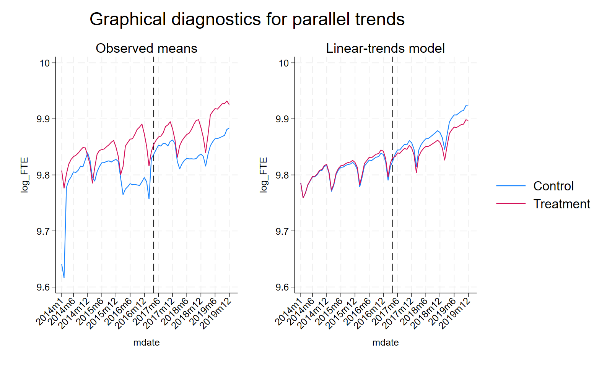

# The Effect of Floods on Municipal Employment: Evidence from a Flood in KwaZulu-Natal

Stata code for my Honours research assignment in Economics at Stellenbosch University (2026).
**The paper: [docs/paper.pdf](docs/paper.pdf).**

**Question.** Did the May 2017 flood in KwaZulu-Natal change formal employment in the
affected local municipalities, and did tradable and non-tradable sectors respond differently?

**Data.** The SARS–National Treasury *Spatial Tax Panel* (v5): monthly full-time-equivalent
(FTE) employment by local municipality and industry for 2014–2019, plus each municipality's
share of importing firms and its median income. The data are built from tax records.

**Method.**
1. Build a municipality × month panel and group 1-digit SIC industries into tradable
   (primary, manufacturing, services) and non-tradable (government, services) sectors.
2. Define treated municipalities as those in the flood-affected districts, and drop metros.
3. Select control municipalities in the coastal provinces (Eastern Cape, Western Cape,
   KwaZulu-Natal) with **propensity-score matching** (`psmatch2`, logit) on pre-flood (2013)
   employment and sector composition.
4. Estimate **difference-in-differences** models (`xtdidregress`) of log FTE for treatment
   windows of 1, 3, 6 and 12 months, with lagged sector shares and import share as controls
   and standard errors clustered by municipality. Then test parallel trends (`estat ptrends`,
   `estat granger`), run the same model by sector, and add robustness checks (wild bootstrap,
   alternative control group, `reghdfe` with municipality-specific trends).

<p align="center"></p>

## Repository layout

```
master.do                 run everything (sets paths, installs packages, runs code/01-09)
config_local.example.do   copy to config_local.do to point $raw at your data folder
code/
  01_build_industry.do    monthly FTE by industry → tradable / non-tradable aggregates
  02_build_inputs.do      monthly FTE, import share, median income, municipal boundaries
  03_build_panel.do       merge into a municipality-month panel, sector shares, treated districts
  04_psm_controls.do      propensity-score matching of control municipalities
  05_did_sample.do        matched sample, treatment-window dummies, log sector FTE
  06_descriptives.do      summary-statistics tables
  07_main_did.do          main DiD results (1/3/6/12-month windows), parallel-trends tests
  08_sector_did.do        DiD by sector
  09_robustness.do        wild bootstrap, alternative control group, other checks
exploratory/              original working script and side analyses (not part of the pipeline)
data/README.md            where to download the data and where to put it
docs/                     paper and figure
output/                   created by master.do (git-ignored)
```

## How to run

Requirements: **Stata 18 or later** (`dtable` and `collect export` need 18, `xtdidregress` needs 17).

1. Download the data as described in [`data/README.md`](data/README.md).
2. In Stata:
   ```stata
   cd "path/to/this/repository"
   do master.do
   ```
   `master.do` installs any missing SSC packages, writes intermediate files to `data/work/`,
   and writes tables, the parallel-trends figure and a log to `output/`.

The control group is set in `master.do` with `global controls`:

- `"thesis"` (default): the 24 municipalities used in the paper (10 treated, 14 controls).
- `"psm"`: the control group produced by `code/04_psm_controls.do` as written (10 treated, 10 controls).

SSC packages (installed automatically): `psmatch2` (includes `pstest` and `psgraph`),
`reghdfe` with `ftools` and `require`, `estout` (`esttab`, `eststo`, `estpost`),
`outreg2`, `geodist` and `spmap`. Tested with StataNow 19.5 and `reghdfe` 6.12.3.

## Reproducibility notes

I wrote this code interactively during the research. To publish it, I split it into an
ordered pipeline **without changing any estimation commands**. Each script lists the line
ranges of `exploratory/original_working_script.do` it was copied from. Glue lines added for
the pipeline are marked `* PIPELINE:`, and known issues are marked `* FLAG:`.

What has been checked:

- **Input datasets.** `01` and `02` rebuild every intermediate input from the raw CSVs.
  Each one was checked with `cf` against the files used in the paper and is identical.
- **Analysis dataset and estimates.** With `controls = "thesis"`, `03`–`05` reproduce the final
  analysis dataset (1,622 municipality-months, 24 municipalities) and `07` reproduces its
  estimates exactly (for example, 12-month ATET = −0.0028, N = 1,318).

Known differences:

- **Control group.** Section 5.3 of the paper describes the match that produced the control
  group: log(FTE) and five sector shares as covariates, two nearest neighbours, and no
  exclusion of untreated KwaZulu-Natal municipalities. `04_psm_controls.do` is a later
  version (FTE and municipal area as covariates, one neighbour without replacement, untreated
  KwaZulu-Natal municipalities dropped). Neither version reproduces the paper's list exactly,
  so the list is written into `05_did_sample.do` and used by default.
- **Tables in the paper.** The paper's tables were produced a few days before the final
  dataset was saved. The rebuilt coefficients differ from them in the third decimal place,
  with the same signs and significance.
- **Parallel-trends tests.** Stata's `estat ptrends`, `trendplots` and `granger` need a treatment
  that stays on and controls without time-series operators. They are therefore run on the
  plain DiD model `xtdidregress (log_FTE) (did)`. On the reproducible sample the linear-trends
  test gives F(1, 23) = 0.01, p = 0.91; the paper reports F = 0.12, p = 0.73. The figure above
  is produced by the pipeline; the version in the paper came from an earlier sample.

## Limitations

This was my Honours research project, and I made mistakes along the way that I wouldn't
make now.

- **I didn't keep a complete record of the code behind every result.** I worked interactively,
  ran parts of a long script out of order, and saved intermediate datasets by hand. As a result:
  - the control group in the paper can't be regenerated from the code (see above);
  - the paper's tables came from a version of the data a few days older than the final dataset;
  - I don't know which model the parallel-trends tests in the paper were run after.

  Today I would keep one script per step, run it from top to bottom, and version the code with
  git from the first day.
- **Parallel trends can't be confirmed either way.** The linear-trends test does not reject,
  but with 10 treated municipalities it has little power. Stata's Granger test for
  pre-treatment effects rejects strongly with both control groups, but with monthly data it
  tests about as many coefficients as there are clusters (F(23, 23) and F(18, 19)), so the
  result is unreliable. The flood's timing is exogenous, but that alone doesn't guarantee
  parallel trends: the treated municipalities are on the KwaZulu-Natal coast rather than
  randomly chosen. A comment in my original script says both tests support parallel trends;
  that overstated it. A better check would be an event study with leads grouped into a few
  periods.
- **Small sample.** There are 10 treated and 10–14 control municipalities, so standard errors are
  clustered on only 20–24 groups. The wild-bootstrap check in `09_robustness.do` helps, but the
  estimates are imprecise.
- **The treatment windows switch off.** The 1-, 3-, 6- and 12-month DiD dummies turn back to zero
  after the window, so later months of treated municipalities act as untreated observations. An
  event-study design (for example Callaway and Sant'Anna) would handle the timing more cleanly.

## Author

Stephan Stofberg, Honours in Economics, Stellenbosch University.
