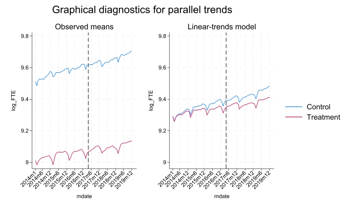

# The Effect of Floods on Municipal Employment: Evidence from a Flood in KwaZulu-Natal

Stata code for my BCom Honours (Economics) research assignment at Stellenbosch University (2026).

**Question.** Did the May 2017 flood in KwaZulu-Natal change formal employment in the
affected local municipalities, and did tradable and non-tradable sectors respond differently?

**Data.** The SARS–National Treasury *Spatial Tax Panel* (v5): monthly full-time-equivalent
(FTE) employment by local municipality and industry for 2014–2019, plus each municipality's
share of importing firms and its median income. The data are built from tax records.

**Method.**
1. Build a municipality × month panel and group 1-digit SIC industries into tradable
   (primary, manufacturing, services) and non-tradable (government, services) sectors.
2. Define treated municipalities as those in the flood-affected districts, and drop metros.
3. Select control municipalities in the Eastern and Western Cape and KwaZulu-Natal with
   **propensity-score matching** (`psmatch2`, 1 nearest neighbour without replacement) on
   pre-flood (2013) size and sector composition.
4. Estimate **difference-in-differences** models (`xtdidregress`) of log FTE for treatment
   windows of 1, 3, 6 and 12 months, with lagged sector shares and import share as controls
   and standard errors clustered by municipality. Then test parallel trends (`estat ptrends`,
   `estat granger`), run the same model by sector, and add robustness checks (wild bootstrap,
   alternative control group, `reghdfe` with municipality-specific trends).

<p align="center"></p>

## Repository layout

```
master.do                 run everything (sets paths, installs packages, runs code/01-09)
config_local.example.do   copy to config_local.do to point $raw at your data folder
code/
  01_build_industry.do    monthly FTE by industry → tradable / non-tradable aggregates
  02_build_inputs.do      monthly FTE, import share, median income, municipal boundaries
  03_build_panel.do       merge into a municipality-month panel, sector shares, treated districts
  04_psm_controls.do      propensity-score matching of control municipalities
  05_did_sample.do        matched sample, treatment-window dummies, log sector FTE
  06_descriptives.do      summary-statistics tables
  07_main_did.do          main DiD results (1/3/6/12-month windows), parallel-trends tests
  08_sector_did.do        DiD by sector
  09_robustness.do        wild bootstrap, alternative control group, other checks
exploratory/              original working script and side analyses (not part of the pipeline)
data/README.md            where to download the data and where to put it
docs/                     figures
output/                   created by master.do (git-ignored)
```

## How to run

Requirements: **Stata 18 or later** (`dtable` and `collect export` need 18, `xtdidregress` needs 17).

1. Download the data as described in [`data/README.md`](data/README.md).
2. In Stata:
   ```stata
   cd "path/to/this/repository"
   do master.do
   ```
   `master.do` installs any missing SSC packages, writes intermediate files to `data/work/`,
   and writes tables and a log to `output/`.

SSC packages (installed automatically): `psmatch2` (includes `pstest` and `psgraph`),
`reghdfe` with `ftools` and `require`, `estout` (`esttab`, `eststo`, `estpost`),
`outreg2`, `geodist` and `spmap`. Tested with StataNow 19.5 and `reghdfe` 6.12.3.

## Reproducibility notes

I wrote this code interactively during the research. To publish it, I split it into an
ordered pipeline **without changing any estimation commands**. Each script lists the line
ranges of `exploratory/original_working_script.do` it was copied from. Glue lines added for
the pipeline are marked `* PIPELINE:`, and known issues are marked `* FLAG:`.

What has been checked:

- **Input datasets.** `01` and `02` rebuild every intermediate input from the raw CSVs.
  Each one was checked with `cf` against the files used in the thesis and is identical.
- **Panel and estimates.** Given the same matched control group, `03`–`05` reproduce the final
  analysis dataset, and `07` reproduces its estimates exactly.

Known differences:

- **Matched controls.** `04_psm_controls.do` as written selects a different set of control
  municipalities from the one used in the thesis. The thesis used 14 controls, including
  several KwaZulu-Natal municipalities that the code excludes, so that list came from an
  earlier version of the matching step.
- **Tables in the thesis.** The thesis tables were produced a few days before the final
  dataset was saved. The rebuilt coefficients differ from them in the third decimal place,
  with the same signs and significance.

## Author

Stephan Stofberg, BCom Honours (Economics), Stellenbosch University.
